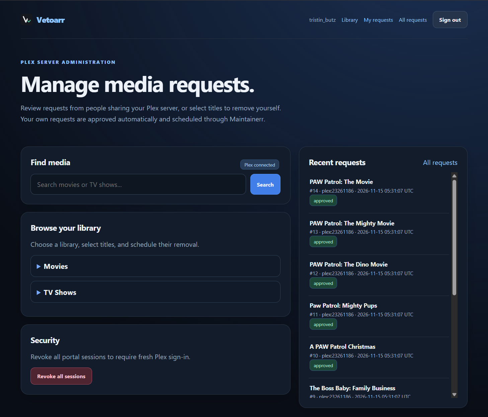
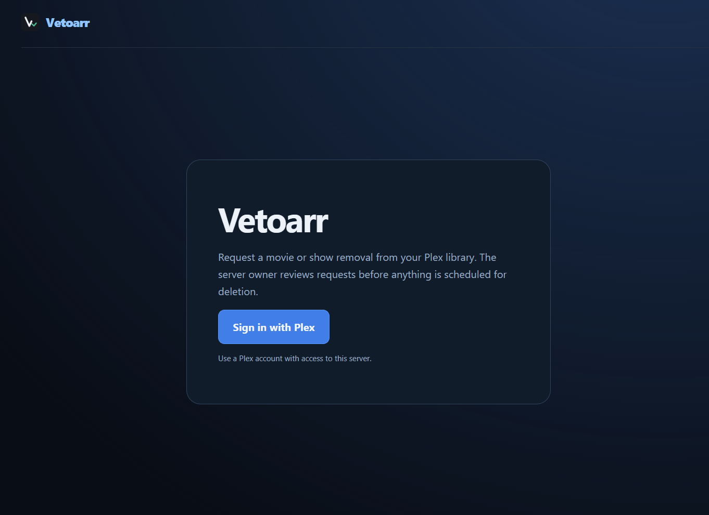
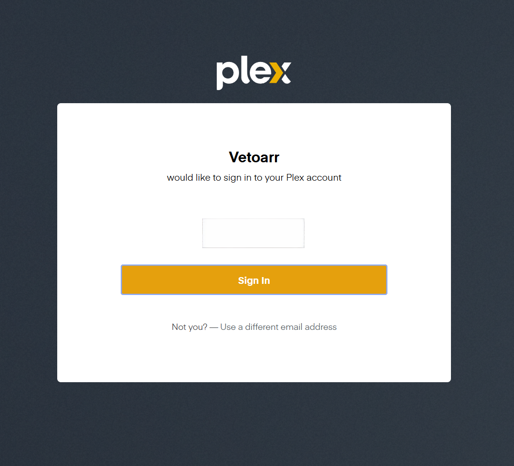

# Vetoarr


[](https://github.com/Muddoggg/Vetoarr/actions/workflows/ci.yml)


**Let people on your Plex server request movies and shows for deletion without giving them access to your media management tools.**

Vetoarr lets the people you share your Plex server with request movies and TV shows to be removed. They sign in with Plex, find what they want removed, and send a request. You decide what gets deleted without giving anyone access to your files, Radarr, Sonarr, or Maintainerr. Requests you submit as the server owner are approved automatically, but still go through the same checks.

Once a request is approved, the portal adds the title to the right **Maintainerr** collection. Maintainerr handles the deletion schedule. The portal never deletes files directly.

> **Heads up:** Approving a request can lead to permanent deletion after the configured delay. Only test with titles you actually want to remove.

## How it works

```text
Plex account -> Plex SSO -> Verify access to your Plex server
                                 |
                        Browse eligible libraries
                                 |
                        Select movie(s) / show(s)
                                 |
                     +-----------+-----------+
                     |                       |
                Shared user              Server owner
                     |                       |
               Pending review          Auto-approval
                     |                       |
                Owner approves               |
                     +-----------+-----------+
                                 |
                       Security / library checks
                                 |
                   Correct Maintainerr collection
                                 |
                    Scheduled downstream deletion
```

## Screenshots

### Admin Dashboard

Browse Plex libraries, search for media, and manage removal requests.



### Plex Sign-In

Users sign in using their existing Plex account.



### Plex SSO Authentication

Plex handles account authentication, so users don't need separate credentials.



## Features

- **Sign in with Plex:** One-click handoff to Plex sign-in; no new accounts or passwords. Users must have access to your Plex server.
- **You stay in control:** Shared users can request deletions, but only the server owner can approve or reject them or manage sessions.
- **Auto-approve your own requests:** Your requests, including bulk requests, go through the normal checks and are approved automatically.
- **Browse and search:** Find titles across Plex libraries and request several at once.
- **Library-specific collections:** Each Plex library can have its own Maintainerr collection, including separate kids and anime libraries.
- **Requests:** Admins can switch between All Requests and My Requests. Shared users can only see their own requests.
- **Duplicate protection:** The database prevents multiple active or approved requests for the same title, while allowing a new request after verified removal.
- **Removal status checks:** Admin pages check approved requests in small batches, and admins can select **Refresh statuses** on the Requests page to check on demand. Status changes to `removed` only when Plex no longer lists the title and the corresponding Maintainerr collections no longer contain it.
- **Safe error handling:** If Maintainerr times out or returns an unclear result, the request is marked `review` instead of being retried automatically.
- **Runs on your server:** Built with Flask and SQLite, packaged for Docker, and designed to run on Unraid or other Linux hosts.

## Discord notifications (optional)

The Plex server owner can configure Discord alerts under **Discord** in the navigation bar.
Create a webhook in your Discord server's channel settings and paste its URL into the admin-only page.
The webhook is stored encrypted in the existing SQLite database (using the application's `SECRET_KEY`), and isn't displayed after saving.
Choose notifications for new shared-user requests, approvals, rejections, and requests requiring manual review. Saving a new or replacement webhook enables notifications by default; you can turn off notifications for a previously saved webhook. **Send test notification** also works with an unsaved URL, and save, test, and removal actions report their results without reloading the page.

Notifications are best-effort. If Discord is unavailable, request approval and deletion processing still operate normally. The webhook URL is a secret: do not put it in your README, logs, screenshots, or public issue reports. Avoid changing `SECRET_KEY`, since that would make the stored webhook undecipherable.

## Request statuses

| Status | Meaning |
| --- | --- |
| `pending` | Waiting for a decision from the server owner |
| `approved` | Maintainerr collection membership was confirmed; deletion may still be scheduled for later |
| `removed` | Plex no longer lists the media and Maintainerr no longer shows it in the configured deletion collections; this does not prove which service deleted the file |
| `rejected` | The owner declined the request; the title may be requested again |
| `review` | The outcome of a Maintainerr submission is uncertain and requires manual investigation before retrying |

## Requirements

- Docker host (Unraid or another Linux Docker environment)
- Plex Media Server and a Plex owner account with the permissions needed by the portal
- Maintainerr configured to manage the relevant libraries and perform the intended deletion actions
- Radarr and/or Sonarr where applicable to your deletion workflow
- HTTPS reverse proxy for internet access, with edge rate limiting and origin protection
- Persistent storage for the portal's SQLite database

The sample `.env.example` and `compose.yaml` are **templates**. Use your own addresses, credentials, Plex libraries, and Maintainerr collection IDs. Do not publish `.env` or the SQLite database.

## Official Docker image

Use the latest published release from [GitHub Releases](https://github.com/Muddoggg/Vetoarr/releases). For an explicitly versioned deployment, use the matching image tag (for example, `ghcr.io/muddoggg/vetoarr:1.2.0`) after confirming the package was published successfully. Keep your persistent `/data` volume when upgrading.

## Installation

1. Clone the repository and create a private environment file:

   ```bash
   git clone https://github.com/Muddoggg/Vetoarr.git
   cd Vetoarr
   cp .env.example .env
   ```

2. Edit `.env` with your Plex and Maintainerr settings, collection IDs, session secret, and deletion delay. Replace all example values with your own.
3. Set up a Maintainerr collection for each Plex library you want to manage. Check that each collection uses the right library, media type, deletion action, and delay. If you only want approved requests added, leave automatic rules disabled.
4. Build and validate the image:

   ```bash
   docker build --pull --no-cache -f Dockerfile.alpine \
     -t vetoarr:local .

   docker run --rm --entrypoint python \
     vetoarr:local /app/test_runtime.py
   ```

5. Deploy the container with persistent `/data` storage and your private `.env` file. The app listens on port `8080` inside Docker; map it to a local port on your host. Put it behind HTTPS and do not forward the app port directly from the internet.
6. Sign in as the Plex owner and check the libraries, user permissions, collection mapping, and request history before approving real deletions.

Refer to [SECURITY.md](SECURITY.md) for the public-facing deployment boundary. The example Compose file is not a substitute for reviewing your own Docker and reverse-proxy settings.

## Maintainerr collection mapping

Set the collection IDs in `.env`. The IDs below are examples; yours may be different.

| Plex library | Environment variable | Example ID |
| --- | --- | --- |
| Movies | `MOVIE_COLLECTION_ID` | `1` |
| TV Shows | `SHOW_COLLECTION_ID` | `2` |
| Kids Movies | `KIDS_MOVIE_COLLECTION_ID` | `3` |
| Anime Movies | `ANIME_MOVIE_COLLECTION_ID` | `4` |
| Kids TV Shows | `KIDS_SHOW_COLLECTION_ID` | `5` |
| Anime TV Shows | `ANIME_SHOW_COLLECTION_ID` | `6` |

Before adding a title, the portal checks that the Plex library matches Maintainerr's `libraryId`, and that the collection has the right type, action, status, and deletion delay. If something doesn't match, it stops. To allow a one-day delay, set `MIN_DELETE_DAYS=1`.

## Security verification

**Tested November 15, 2026.** These are the results from the tested Docker image and server setup. Other builds and installations need their own checks.

| Check | Recorded result |
| --- | --- |
| Automated security and regression tests | **30 / 30 passed** |
| Trivy HIGH findings | **0 detected** |
| Trivy CRITICAL findings | **0 detected** |
| Gitleaks Git history scan | **0 findings**, 4 commits scanned |
| Gitleaks working-directory scan | **0 findings** |
| SQLite duplicate-active-request check | **Passed** |
| Cloudflare Plex login rate-limiting rule | **Active** in operator's dashboard |
| Direct-origin TCP/443 check from one external scanner | **Filtered** |

**Trivy scanned:** Docker image `local/media-approval-portal:dashboard-ui-fixed`, Alpine 3.24.4 and installed Python packages, with the vulnerability DB updated for the November 15, 2026 scan. Several tests use simulated Plex and Maintainerr responses, so passing them does not confirm that actual files were deleted.

To reproduce the main checks on your own image:

```bash
docker run --rm --entrypoint python \
  local/media-approval-portal:dashboard-ui-fixed /app/test_runtime.py

docker run --rm -v /var/run/docker.sock:/var/run/docker.sock:ro \
  aquasec/trivy:latest image --scanners vuln \
  --severity HIGH,CRITICAL --exit-code 1 \
  local/media-approval-portal:dashboard-ui-fixed

gitleaks git . --redact
gitleaks dir . --redact
```

For the full list of tests and scan details, see [Security Testing Results](SECURITY_TESTING.md).

**What these results do not cover:** This project has not had an independent penetration test. The external port test checked IPv4 from one location, not IPv6 or every port. The built-in Plex login limit is tied to a browser session, so public installations also need rate limiting at the proxy or firewall. A clean scan cannot rule out every security bug.

## Deployment security

- Keep the Plex token, encryption/session keys, and runtime database out of Git.
- Restrict public traffic to your trusted reverse proxy or a tunnel; do not expose the portal's application port or Unraid/NPM administration ports to WAN.
- Use HTTPS, rate-limit `POST /auth/plex/start`, and verify origin restrictions independently.
- Preserve least-privilege Docker settings where supported: non-root execution, read-only filesystem, dropped capabilities, `no-new-privileges`, PID limits, and temporary writable storage.
- Verify shared, owner, and unshared Plex account behavior in your own environment.
- Inspect Maintainerr membership before reconciling `review` requests; never retry ambiguous destructive operations blindly.

See [SECURITY.md](SECURITY.md) for deployment safeguards and private vulnerability reporting.

## A note about deletion

Vetoarr handles requests and approvals. Maintainerr and your media management apps handle actual deletion. An `approved` request means Maintainerr accepted it; it does **not** mean the file is gone. Vetoarr can later mark it `removed` when Plex no longer lists it and it is absent from Maintainerr's configured deletion collections. If a service cannot be checked, the request stays approved. Checking removal does not delete or re-submit anything, and cannot prove which app performed the deletion.


## Development Transparency & Maintainer Background

### AI-Assisted Development

Vetoarr was developed with assistance from AI tools, including ChatGPT, for coding, debugging, testing, and documentation. AI was used to support development, while technical decisions, deployment, and ongoing maintenance remain my responsibility.

### Maintainer Background

I'm a **Senior Software Engineer with over six years of professional experience**.

My professional background includes:

- **Software Engineering:** C#, .NET, Python, Flask, APIs, and application architecture
- **DevOps & Infrastructure:** Docker, CI/CD, Jenkins, GitHub Actions, and NGINX
- **Cloud & Databases:** AWS, Azure, SQL, Redis, and cloud integrations
- **Security & Quality:** Authentication, authorization, automated testing, and secure application development

### Open Source & Accountability

I maintain Vetoarr, review contributions, fix bugs, and keep releases and documentation up to date as the project evolves.

GitHub Actions runs regression tests and Trivy container scans to help catch issues before release. They're useful checks, though no test suite or scan can catch everything.

Vetoarr is open source, so feel free to look through the code, report a bug, suggest an improvement, or open a pull request. If you find a security issue, please use the private reporting instructions in [SECURITY.md](SECURITY.md) instead of posting it publicly.


## Contributing

Bug reports, fixes, and suggestions are welcome. Please do not include API keys, Plex tokens, private addresses, or sensitive logs in issues. For security problems, follow [SECURITY.md](SECURITY.md).

## Support the Project

Vetoarr is free and open source. If you find it useful, you can support its continued development.

[](https://buymeacoffee.com/tristinb)
